<div align="center">


# Triagem NIP

**Case de UX/UI e front-end: triagem das NIPs da ANS, as reclamações de beneficiários que chegam a uma operadora de saúde com prazo para resposta.**


[Ver o protótipo](https://fernandopinhel.github.io/ans/) ·
[Como rodar](#como-rodar-localmente) ·
[O case](#o-case)

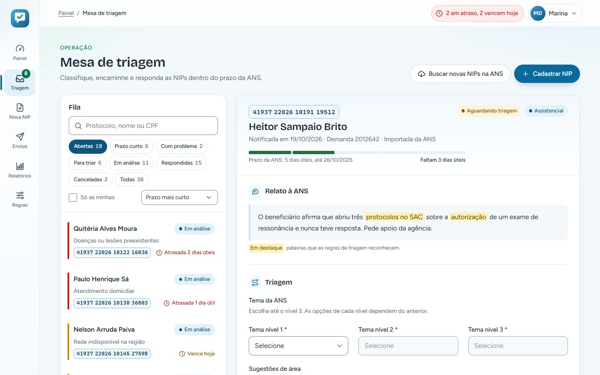

</div>

> **Este é um case de portfólio.** O projeto nasceu em 2020, numa empresa onde trabalhei,
> e foi recriado aqui para mostrar o processo e o resultado. Para preservar a empresa e o
> cliente, a interface usa a operadora fictícia **Acolhe Saúde**. Beneficiários, CPFs,
> cartões, protocolos, áreas, e-mails e relatos são todos de exemplo, e nada do que você
> digita sai do seu navegador.

---

## Sumário

- [O case](#o-case)
  - [Contexto e problema](#contexto-e-problema)
  - [Objetivo](#objetivo)
  - [Decisões de design](#decisões-de-design)
  - [Um layout só deste case](#um-layout-só-deste-case)
  - [A marca fictícia](#a-marca-fictícia)
  - [Revisitando o case](#revisitando-o-case)
- [A jornada, tela a tela](#a-jornada-tela-a-tela)
- [O que funciona no protótipo](#o-que-funciona-no-protótipo)
- [Acessibilidade](#acessibilidade)
- [Tecnologias e arquitetura](#tecnologias-e-arquitetura)
- [Como rodar localmente](#como-rodar-localmente)
- [Publicação no GitHub Pages](#publicação-no-github-pages)
- [Segurança e privacidade](#segurança-e-privacidade)
- [Limitações](#limitações)
- [Próximos passos](#próximos-passos)
- [Histórico](#histórico)
- [Autor](#autor)

---

## O case

### Contexto e problema

Quando um beneficiário de plano de saúde não consegue resolver um problema com a operadora,
ele pode reclamar na ANS, a agência que regula o setor. A reclamação vira uma **NIP**
(Notificação de Intermediação Preliminar) e a operadora tem um prazo curto para responder:
**5 dias úteis** quando o caso é assistencial (cobertura, rede, prazo de atendimento) e
**10 dias úteis** quando não é (mensalidade, contrato, cadastro). Perder o prazo pode virar
multa.

Antes do sistema, a equipe que recebia as NIPs:

- baixava as notificações do portal da agência e copiava os dados à mão;
- decidia sozinha qual área deveria cuidar de cada caso, lendo relato por relato;
- avisava a área por e-mail, sem um texto padrão e sem registro do que foi enviado;
- lançava cada NIP no CRM de relacionamento, onde as áreas trabalham;
- não tinha uma visão clara de quais NIPs estavam perto de vencer.

### Objetivo

Criar um sistema interno para a equipe de relacionamento com a ANS, onde:

1. as NIPs **chegam sozinhas** da agência, e as que vêm com dados faltando ficam separadas para correção;
2. cada NIP é **classificada num tema** da ANS em 3 níveis;
3. o sistema **sugere a área** que deve cuidar do caso, explicando o porquê;
4. a área recebe um **aviso por e-mail** com um modelo pronto, e a NIP **sobe para o CRM** todo dia às 6h;
5. a **resposta à ANS** fica registrada, e o **prazo em dias úteis** está sempre à vista.

### Decisões de design

| Decisão | Por quê |
| --- | --- |
| **Mesa de triagem** com a fila e a ficha lado a lado | Triar é ler um caso atrás do outro. Com a fila sempre visível, a pessoa passa para a próxima NIP sem voltar para uma lista. |
| Fila ordenada pelo **prazo mais curto** | O risco está no prazo, não na ordem de chegada. As NIPs atrasadas e as que vencem hoje aparecem primeiro, com uma faixa colorida. |
| **Régua de dias úteis** em cada ficha | "Faltam 2 dias úteis" é mais fácil de sentir quando se vê 3 de 5 blocos já cheios. O texto vem junto, para não depender da cor. |
| **Relógio da ANS** na barra superior | Em qualquer tela, a pessoa sabe quantas NIPs estão em atraso ou vencem hoje, com um clique até elas. |
| **Palavras-chave em destaque** no relato | Mostra de onde veio a sugestão de área. Quem tria confere o motivo em vez de confiar numa caixa-preta. |
| Sugestão de área **com o motivo escrito** | "Porque cuida do tema X e o texto cita 'reembolso'." Quando as regras apontam áreas diferentes, as duas aparecem e a pessoa decide. |
| **Prévia do e-mail** antes de encaminhar | O aviso sai com as variáveis já trocadas pelos dados da NIP. Se a área não tem e-mail cadastrado, o sistema avisa antes. |
| Protocolo como **carimbo** em blocos de 5 | Um número de 20 dígitos fica mais fácil de ler e de conferir em voz alta quando dividido. |
| **Regras de triagem** editáveis pela equipe | Temas, palavras-chave, áreas, e-mails e modelos mudam com frequência. Quem opera ajusta sem depender de TI. |
| **Falhas de envio** com a solução ao lado | Se a NIP não sobe para o CRM, a tela diz o motivo e oferece o conserto: cadastrar o código da área ou trocar a área. |

### Um layout só deste case

Os outros cases do portfólio usam um menu lateral claro (OPME) e uma barra de operações no
topo (Sinistro Auto). Este usa um **trilho claro e estreito**, com ícones e rótulos curtos,
como as gavetas de uma mesa de triagem, para deixar o máximo de espaço para a fila e a ficha.
Os elementos visuais vêm do domínio: o **carimbo** do protocolo, a **régua** de dias úteis, o
**relógio** dos prazos e o **marca-texto** nas palavras do relato. No celular, o trilho vira
uma gaveta com os nomes completos e a ficha da NIP ocupa a tela inteira.

### A marca fictícia

**Acolhe Saúde** é uma operadora inventada para o case. O nome vem de *acolher*: uma
reclamação na ANS é, antes de tudo, alguém pedindo ajuda.

O símbolo é um **balão de fala** com um **visto em verde-menta**: a reclamação que chega e a
reclamação que recebe resposta. Ele funciona como favicon e aparece no trilho e no login. A
paleta usa azul-clarinho e verde-menta, cores que lembram clínica e cuidado, com azul-marinho só no login.

### Revisitando o case

Em 2026 o protótipo foi revisitado. A versão original tinha cerca de 40 telas feitas com
Bootstrap e jQuery, todas só visuais, com dados fixos e a marca do cliente. Agora:

- **Tudo funciona de ponta a ponta**: importar, corrigir, classificar, encaminhar, responder, cancelar, enviar ao CRM e gerar relatórios.
- **As 40 telas viraram 9**, sem perder nenhuma função: consultar, cadastrar, editar e ver detalhes passaram a ser a mesma tela, e relatório e planilha também.
- **Um design system próprio**, claro e suave em azul e verde-menta, com login escuro, sem framework de CSS.
- **Acessibilidade revisada para a WCAG 2.2 AA**, verificada com axe em todas as telas.
- **Textos mais próximos e humanos**, com mensagens de erro que explicam como corrigir.
- **Zero dependências de runtime**: saíram Bootstrap, jQuery, Popper, nice-select, datetimepicker, os ícones e as fontes da marca original e cerca de 22 MB de arquivos.
- **Dados fictícios** gerados de forma determinística, com CPFs válidos e datas contadas em dias úteis a partir de hoje.

---

## A jornada, tela a tela

| Login | Painel do dia |
| --- | --- |
| 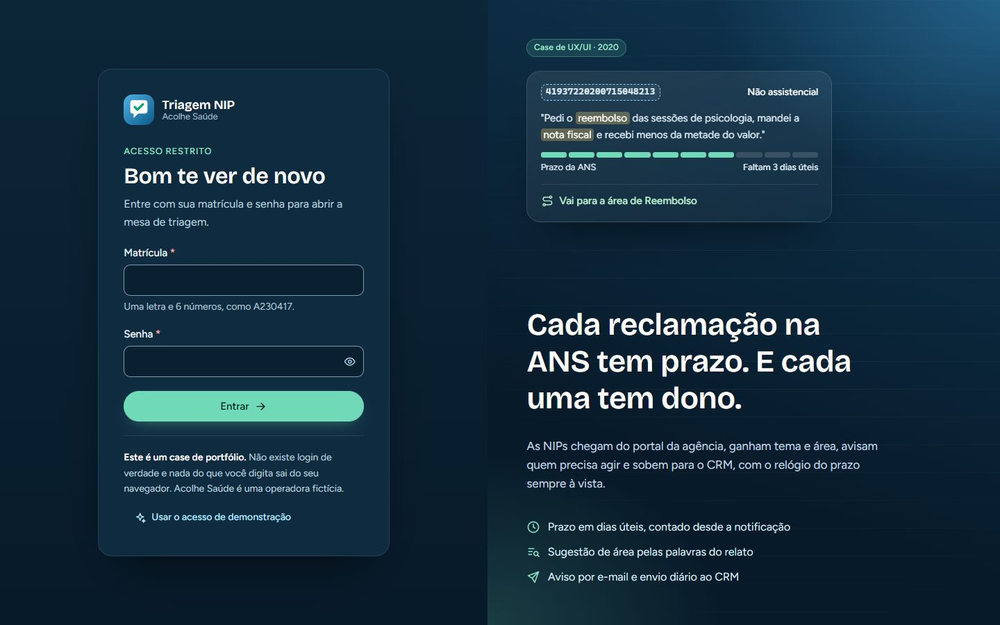 | 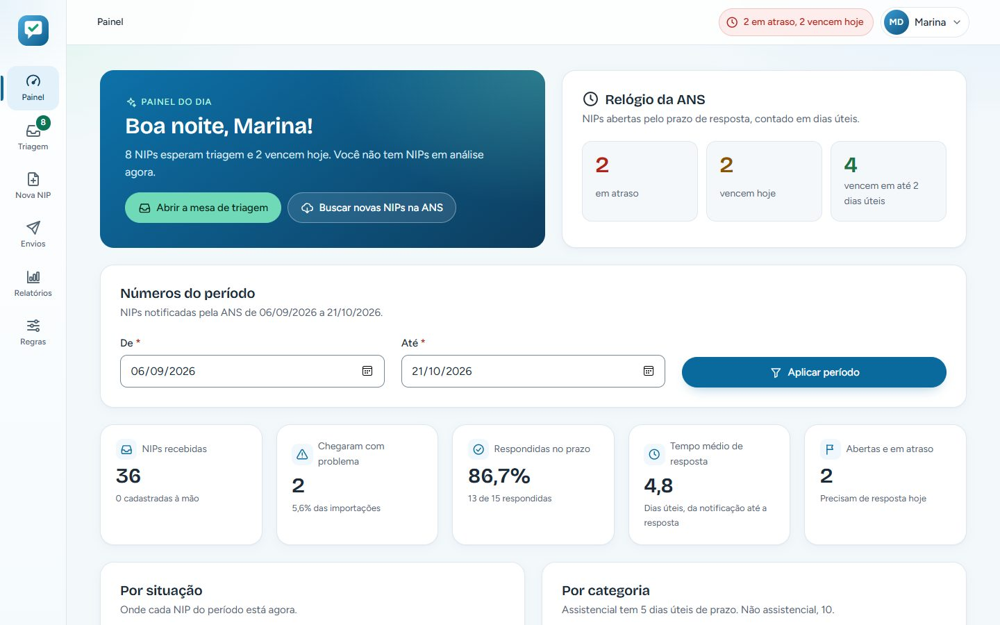 |

| Sugestões de área | Aviso para a área |
| --- | --- |
| 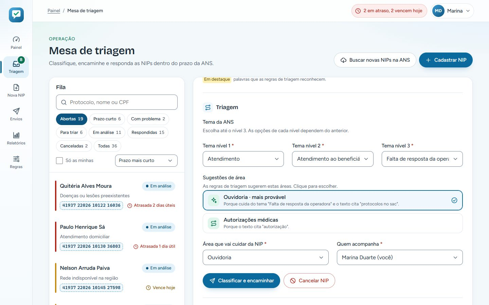 | 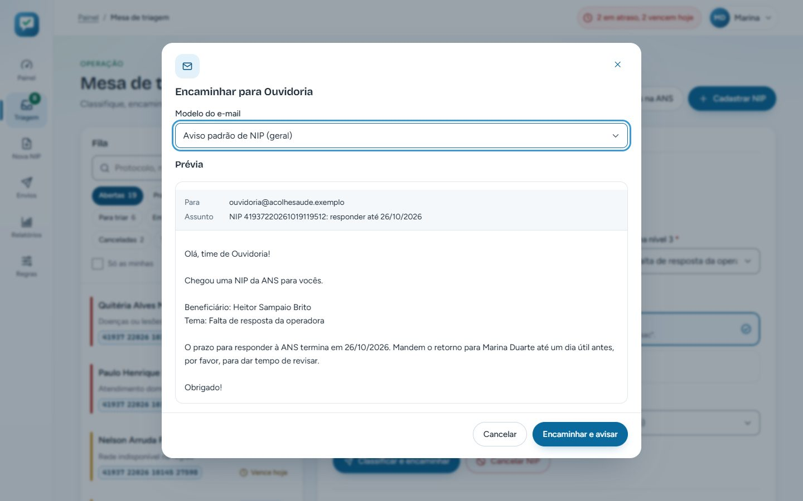 |

| Resposta à ANS | Cadastro com erros |
| --- | --- |
| 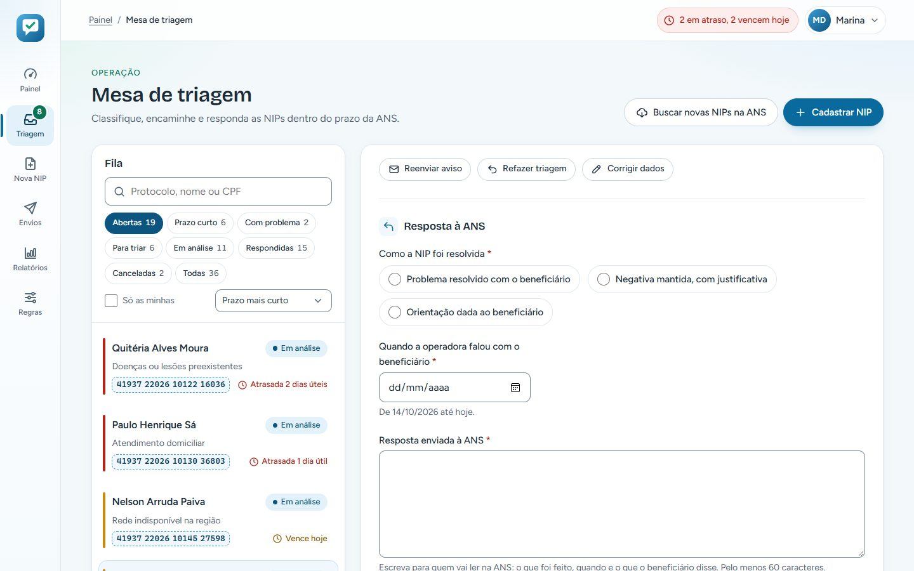 | 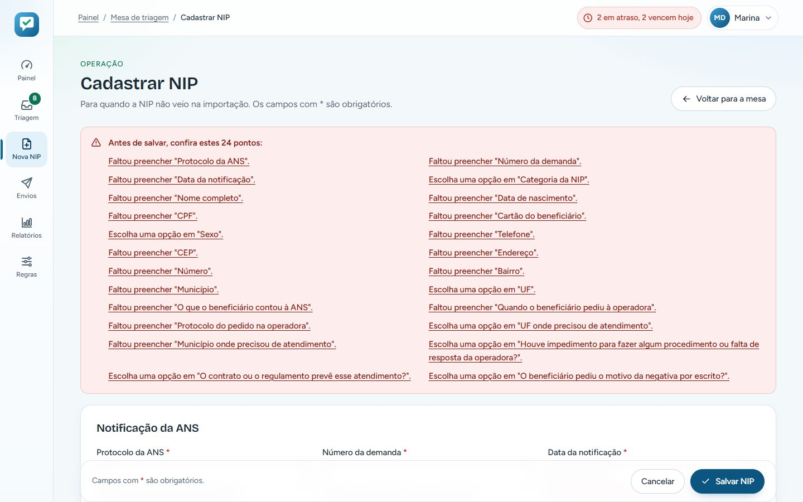 |

| Envios ao CRM | Relatórios |
| --- | --- |
| 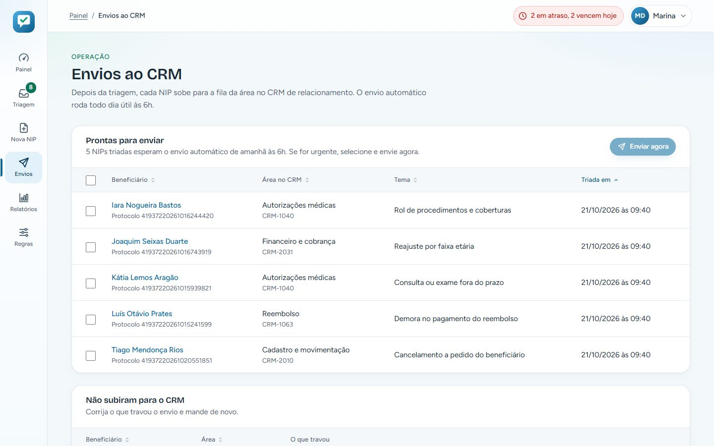 | 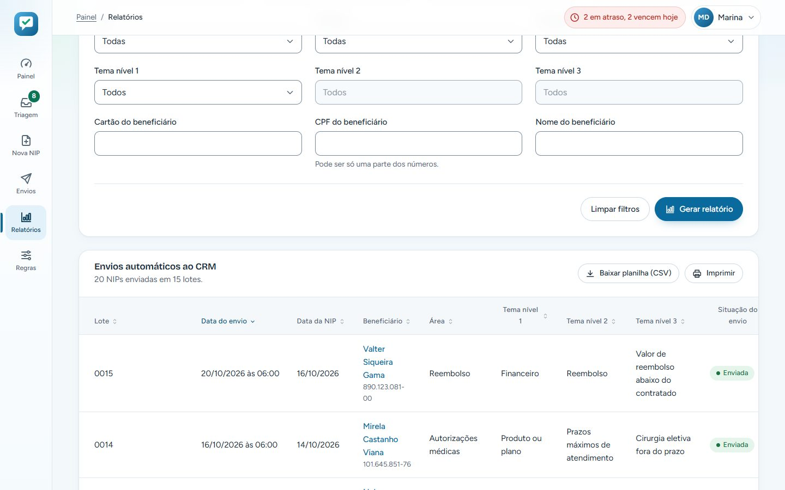 |

| Palavras-chave | Modelo de e-mail |
| --- | --- |
| 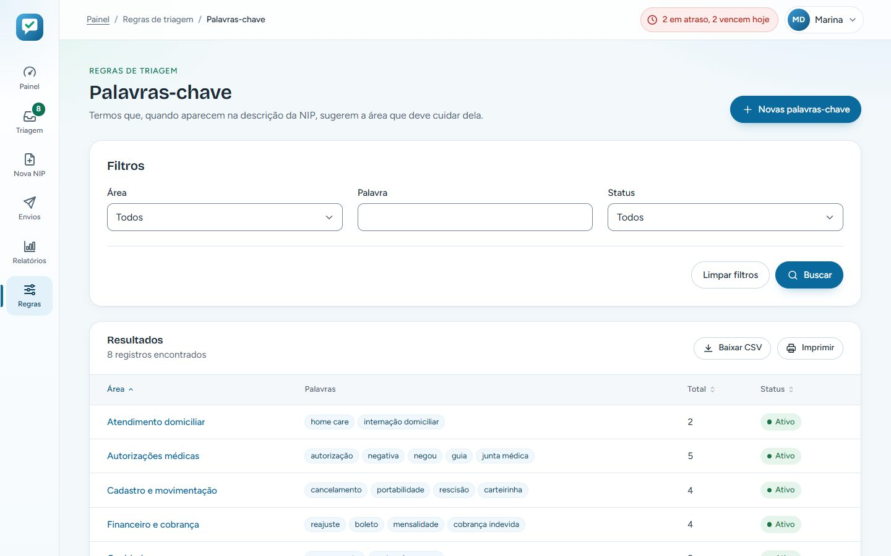 | 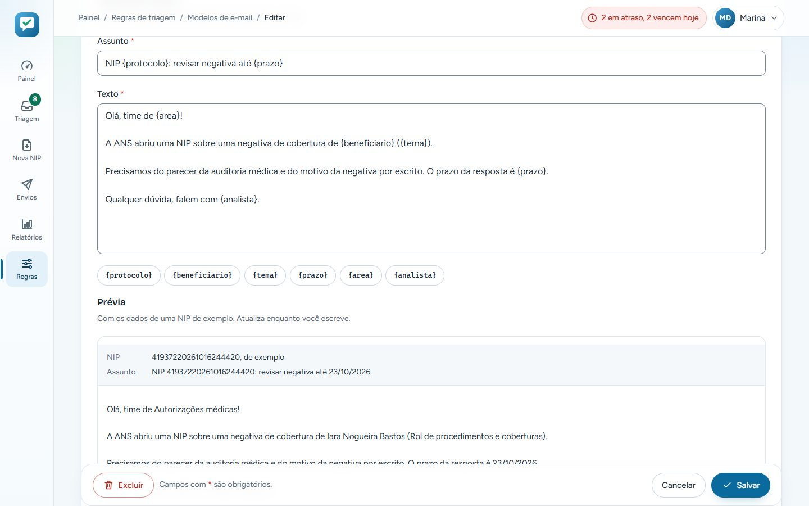 |

| Ficha no celular | Menu no celular |
| --- | --- |
| 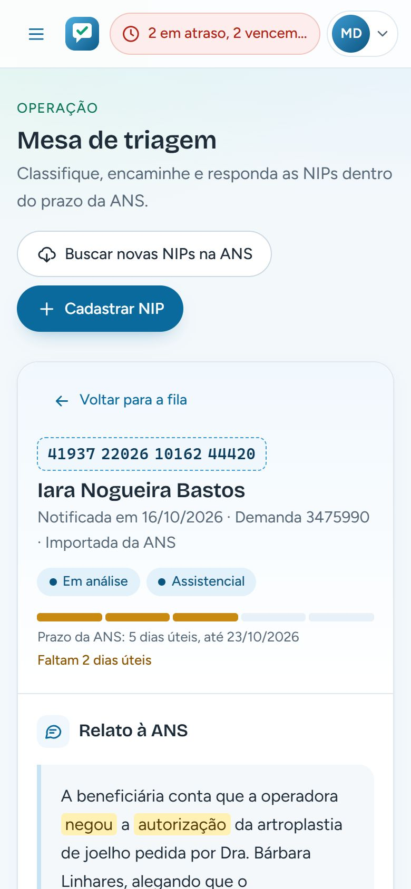 | 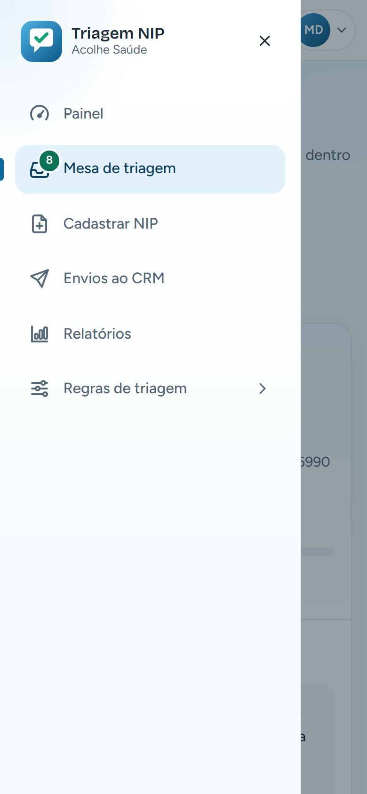 |

| Tela | Arquivo | O que faz |
| --- | --- | --- |
| Login | `login.html` | Matrícula e senha, com validação e botão de acesso de demonstração. Não há autenticação real. |
| Painel | `inicio.html` | Relógio da ANS, números do período (recebidas, com problema, no prazo, tempo médio), gráficos por situação, categoria, tema e área, e o que vence primeiro. |
| Mesa de triagem | `triagem.html?id=...` | Fila com busca, filtros e ordenação ao lado da ficha: relato, triagem, resposta, perguntas da ANS, beneficiário e histórico. |
| NIP | `nip.html?id=...` | Cadastro manual de NIP e correção das que chegaram com dados faltando. |
| Envios ao CRM | `envios.html` | NIPs prontas para envio, falhas com a correção ao lado e histórico de lotes manuais e automáticos. |
| Relatórios | `relatorios.html` | NIPs importadas, envios manuais e automáticos, com filtros e planilha CSV. |
| Regras de triagem | `consulta.html?tipo=...` | Uma tela para as 6 regras: temas, palavras-chave, áreas e temas, áreas do CRM, e-mails e modelos. |
| Cadastro de regra | `cadastro.html?tipo=...&id=...` | Inclusão e edição, com histórico e exclusão protegida. |

---

## O que funciona no protótipo

**Chegada das NIPs**
- "Buscar novas NIPs na ANS" simula a importação: chegam 3 NIPs, uma delas sem CPF.
- NIPs com dados faltando ficam como "Com problema", com a lista do que falta e links para cada campo na correção. Corrigida, a NIP volta para a fila.
- Cadastro manual com validação de protocolo (20 números e sem duplicidade), CPF, cartão, datas e telefone. A pergunta das 48 horas só aparece quando o beneficiário pediu a negativa por escrito.

**Triagem**
- Tema em cascata: cada nível só mostra o que existe dentro do anterior.
- Sugestão de área pela associação com o tema (a mais específica vence) e pelas palavras-chave do relato. A área mais provável já vem escolhida e acompanha o tema até a pessoa escolher outra.
- Encaminhamento com prévia do e-mail, escolha do modelo (o da área tem prioridade sobre o geral) e aviso quando a área não tem e-mail.
- Reenviar aviso, refazer a triagem, cancelar com motivo e registrar a resposta à ANS, que fica marcada como dentro ou fora do prazo.

**Envios ao CRM**
- O envio automático roda todo dia útil às 6h com o que foi triado antes. Dá para selecionar e enviar na hora.
- A NIP não sobe se a área não tiver código no CRM ou estiver inativa. A falha aparece com o motivo, o atalho para cadastrar o código e a opção de trocar a área e tentar de novo.

**Regras de triagem**
- Temas em até 3 níveis, sem repetir nome no mesmo lugar e sem um tema ficar dentro dele mesmo.
- Palavras-chave e e-mails como listas: Enter adiciona, cada item tem seu botão de remover, e uma palavra não pode sugerir duas áreas.
- Cada tema fica com uma área só. Código do CRM validado e sem repetição.
- Modelos de e-mail com variáveis clicáveis, aviso de variável que não existe e prévia ao vivo.
- Exclusão bloqueada para registros em uso (tema com temas dentro, área com NIPs), com a sugestão de inativar.

**Em todas as listas**
- Filtros lembrados durante a sessão, ordenação por coluna, paginação, planilha CSV e versão para impressão.
- **Restaurar dados de exemplo**, no menu do usuário e no rodapé, volta tudo ao estado original.

---

## Acessibilidade

O protótipo foi revisado para a **WCAG 2.2 nível AA** e verificado com o
[axe-core](https://github.com/dequelabs/axe-core) em todas as telas e estados (erros,
diálogos, gaveta aberta), no desktop e no celular, sem violações.

- **Estrutura**: landmarks, link para pular ao conteúdo, títulos em ordem e trilha de navegação com `aria-current`.
- **Formulários**: rótulo visível em todos os campos, dicas ligadas por `aria-describedby`, erro no próprio campo e num resumo no topo com links que levam ao campo.
- **Validação que não atrapalha**: depois da primeira tentativa, o erro some enquanto a pessoa corrige, e nada muda de lugar quando ela sai do campo.
- **Mesa de triagem**: ao abrir uma NIP, o foco vai para o nome do beneficiário. No celular, "Voltar para a fila" devolve o foco ao item de onde a pessoa veio.
- **Prazo sem depender de cor**: a régua e a faixa da fila sempre vêm com o texto ("Atrasada 2 dias úteis").
- **Destaques do relato** com `<mark>`, que também aparecem no alto contraste do Windows.
- **Diálogos** com `<dialog>` nativo: prendem o foco, fecham com Esc e devolvem o foco a quem abriu.
- **Menu no celular** como gaveta modal: o conteúdo atrás fica `inert`, Esc fecha e o foco volta ao botão.
- **Anúncios** para leitores de tela em ações sem mudança de página: "6 NIPs em Para triar", "Sugestão de área: Reembolso, já escolhida", "Ordenado por Quando".
- **Contraste** de pelo menos 4,5:1 em texto e 3:1 em bordas de campos, alvos de toque de 44 px, suporte a movimento reduzido e ao alto contraste do Windows.

---

## Tecnologias e arquitetura

- **HTML, CSS e JavaScript puros**, sem build, sem framework e sem bibliotecas de runtime.
- **Bricolage Grotesque e Figtree** via Google Fonts, só nos pesos 400, 500 e 600.
- **Ícones** num sprite SVG próprio (`img/icons.svg`).

```text
.
├── index.html            Redireciona para o login
├── login.html            Login (escuro)
├── inicio.html           Painel do dia
├── triagem.html          Mesa de triagem (fila e ficha)
├── nip.html              Cadastro manual e correção de NIP
├── envios.html           Envios ao CRM
├── relatorios.html       Relatórios e planilhas
├── consulta.html         Consulta genérica das regras (?tipo=...)
├── cadastro.html         Cadastro genérico das regras (?tipo=...&id=...)
├── css/app.css           Design system (tokens, trilho, mesa, login, impressão)
├── js/common.js          Estrutura, validação, máscaras, dias úteis, diálogos, tabela, CSV
├── js/data.js            Dados de exemplo, regras de negócio e esquemas das regras
├── js/<página>.js        Comportamento de cada página
├── img/                  Símbolo e sprite de ícones
└── docs/screenshots/     Capturas usadas neste README
```

**Regras guiadas por esquema.** As 6 regras de triagem usam as mesmas duas páginas. Cada uma
é descrita em `js/data.js`: seções, campos (inclusive tema em cascata e listas), filtros,
colunas, duplicidade, regras de negócio e quando a exclusão é bloqueada.

**Prazos em dias úteis.** `somaDiasUteis` e `diasUteisAte` contam de segunda a sexta a partir
da notificação. Todo o resto (régua, fila, relógio, painel, resposta no prazo) parte daí.

**Dados.** O "banco" é um objeto JSON no `sessionStorage` (chave `nip:db`), criado a partir de
um gerador determinístico na primeira visita. As datas são relativas ao dia de hoje, para que
prazos e atrasos façam sentido sempre que alguém abrir o protótipo.

---

## Como rodar localmente

O projeto é estático: basta servir a pasta com qualquer servidor HTTP. Prefira um servidor
ao `file://`, porque a CSP e o sprite de ícones se comportam de forma diferente com arquivos
locais.

```bash
git clone https://github.com/fernandopinhel/ans.git
cd ans

# Opção 1: Python
python3 -m http.server 8080

# Opção 2: Node
npx serve .
```

Depois, acesse <http://localhost:8080> e clique em **Usar o acesso de demonstração**.

Para validar o HTML:

```bash
npx htmlhint@1 "*.html"
```

---

## Publicação no GitHub Pages

O site é publicado direto da branch `master` (**Settings → Pages → Deploy from a branch**,
pasta `/`). A cada merge na `master`, o GitHub atualiza o site em cerca de um minuto. O
arquivo `.nojekyll` faz o GitHub servir os arquivos como estão, sem processar com Jekyll.

Endereço: <https://fernandopinhel.github.io/ans/>

---

## Segurança e privacidade

- **Nenhum dado sai do navegador.** Não há back-end. Sessão e cadastros ficam no `sessionStorage` e somem ao fechar a aba. O PDF da notificação não é lido: o protótipo guarda só o nome do arquivo.
- **Content Security Policy** em todas as páginas: `script-src 'self'`, `style-src` sem `'unsafe-inline'`, `object-src 'none'`, `base-uri 'self'` e `form-action 'self'`. Só o Google Fonts é liberado como origem externa.
- **Sem JavaScript nem CSS inline.** Nenhum `<script>` inline, handler `on*=` ou atributo `style=` no HTML.
- **Sem injeção de HTML.** Os elementos são montados com `createElement` e `textContent`, nunca com `innerHTML`. O destaque das palavras do relato também é montado nó a nó.
- **CSV seguro**: valores que começam com `=`, `+`, `-` ou `@` são neutralizados para não virarem fórmula no Excel.
- **Referrer Policy** `strict-origin-when-cross-origin` e `noindex` para buscadores.

O GitHub Pages não permite definir cabeçalhos HTTP, por isso a CSP vai em `<meta>` e
`frame-ancestors` não se aplica. Veja também o [SECURITY.md](SECURITY.md).

---

## Limitações

- É um **protótipo**: não há back-end, autenticação real, integração com o portal da ANS, envio de e-mail nem CRM de verdade.
- Os dados vivem só na aba do navegador. Outra aba ou outro navegador começa do zero.
- Os dias úteis não consideram feriados.
- A marca Acolhe Saúde e todos os dados são fictícios. O repositório **não tem licença de código aberto**.

---

## Próximos passos

- [ ] CI com HTMLHint, bloqueio de código inline, testes de fluxo (Playwright) e auditoria de acessibilidade (axe).
- [ ] Calendário de feriados nacionais e estaduais no cálculo do prazo.
- [ ] Anexos da resposta à ANS e trilha do que a área respondeu dentro do CRM.
- [ ] Distribuição automática das NIPs entre as pessoas da equipe, pela carga de cada uma.
- [ ] Relatório de reincidência: beneficiários e temas que voltam à ANS.

---

## Histórico

### 2026-10: Case revisitado

- Operadora fictícia Acolhe Saúde, com símbolo de balão de fala e visto em verde-menta, no lugar da marca do cliente original.
- Reescrita completa em HTML, CSS e JavaScript puros, com layout próprio (trilho e mesa de triagem), visual claro em azul-clarinho e verde-menta e login escuro.
- Fluxos funcionais de ponta a ponta: importação, correção, triagem com sugestão de área, aviso por e-mail, resposta à ANS, envios ao CRM, relatórios e 6 regras de triagem.
- As cerca de 40 telas originais viraram 9.
- Acessibilidade revisada para a WCAG 2.2 AA, verificada com axe.
- Saíram Bootstrap, jQuery, plugins, as fontes e os ícones da marca original e cerca de 22 MB de arquivos.
- Publicação no GitHub Pages e `SECURITY.md`.

### 2020 a 2023: Versão original

Protótipo navegável criado na empresa onde o projeto nasceu, com Bootstrap e jQuery.

---

## Autor

**Fernando Pinhel**, Fullstack Designer (UX/UI, Design Systems e Front-end)
[fernandopinhel.com.br](https://fernandopinhel.com.br) · [GitHub](https://github.com/fernandopinhel)
